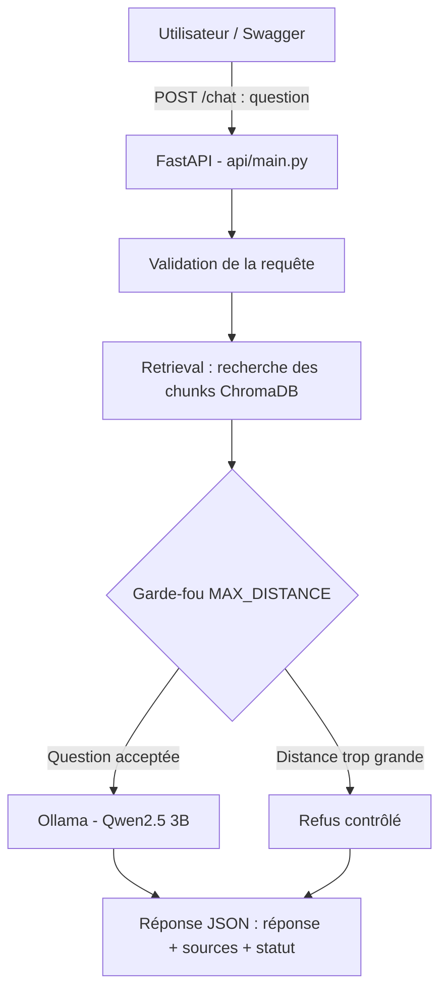
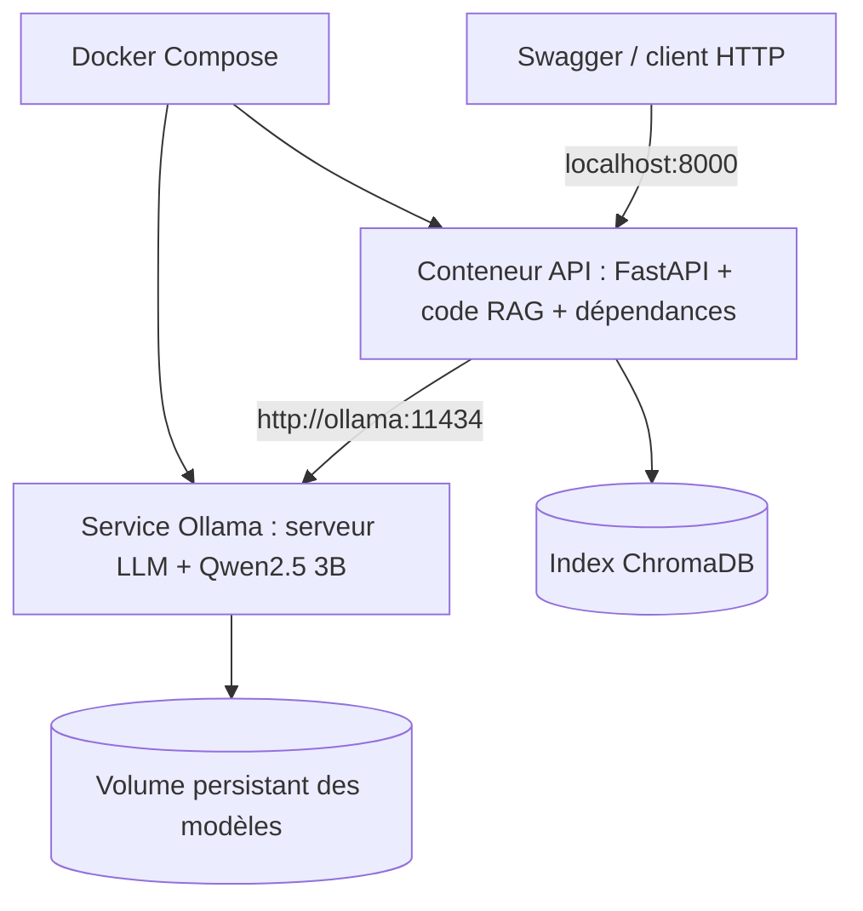

# DocuMind — RAG, FastAPI, Ollama et Docker

DocuMind recherche des passages dans un corpus documentaire (retrieval), applique un garde-fou de pertinence, puis utilise Ollama/Qwen2.5 3B pour générer une réponse lorsque le contexte est suffisant.

> Adapte les noms de variables aux fichiers réels `config.py` et `src/llm_provider.py`. Ne publie jamais `.env`, tokens, secrets, `.venv` ou données privées.

## Sprint 6 — flux de requête



1. Le client envoie une question.
2. FastAPI valide la requête et appelle le pipeline RAG existant.
3. Le retrieval recherche les chunks dans l'index.
4. Le garde-fou contrôle la distance du meilleur chunk.
5. Si la question est acceptée, Ollama génère une réponse basée sur le contexte.
6. L'API retourne réponse, sources et statut de refus.

Exemple de requête indicative :

```json
{"question": "How do I define a POST route in FastAPI?"}
```

Exemple de réponse indicative (les champs exacts doivent correspondre à ton code) :

```json
{
  "answer": "A POST route can be defined with the app.post decorator.",
  "sources": ["tutorial/example.md"],
  "refused": false
}
```

### Sprint 6 — tâches

- Créer `api/main.py` avec `app = FastAPI(...)`.
- Définir les modèles Pydantic de requête et de réponse.
- Créer `POST /chat` en réutilisant retrieval, garde-fou et génération déjà présents.
- Gérer question invalide, index absent, Ollama indisponible et timeout.
- Vérifier les sources retournées et documenter les erreurs HTTP.
- Tester au moins 3 questions via Swagger.

Commandes depuis PowerShell, à la racine du projet :

```powershell
.\.venv\Scripts\Activate.ps1
ollama list
uvicorn api.main:app --reload --host 127.0.0.1 --port 8000
```

Swagger : http://127.0.0.1:8000/docs

Statuts indicatifs : `422` pour une entrée invalide, `503` pour un service ou index indisponible, `504` pour un timeout. Garde un contrat cohérent avec ton code.

**Definition of Done :** `uvicorn api.main:app` démarre, Swagger affiche `/chat`, trois questions sont testées, les sources viennent du retrieval et les erreurs sont propres.

**Ligne CV :** Exposition d’un système RAG via une API REST FastAPI documentée, avec gestion des erreurs, sources et garde-fou de pertinence.

## Sprint 7 — architecture Docker visée



**Important pour ton Docker actuel :** tu as indiqué un conteneur `documind-ollama`, image `ollama/ollama:latest`, avec le mapping `11435:11434`. Depuis Windows, son endpoint peut être `http://localhost:11435`. Mais depuis le conteneur API, `localhost` désigne l'API elle-même. Si les deux services sont définis dans le même `compose.yaml`, l'API doit généralement appeler `http://ollama:11434` si le service Compose est nommé `ollama`.

### Sprint 7 — tâches

- Créer `tests/test_regression.py` et comparer les métriques à une baseline figée du Sprint 5.
- Ajouter des tests unitaires à `src/retrieval.py` et au vrai module d'ingestion du projet.
- Créer `Dockerfile` pour l'API et `.dockerignore`.
- Créer `compose.yaml` si tu veux lancer API et Ollama ensemble.
- Rendre le modèle Qwen2.5 3B disponible dans un volume Ollama persistant.
- Tester l'API et Ollama ensemble.

Commandes après création et vérification de `Dockerfile` et `compose.yaml` :

```powershell
pytest tests -q
docker compose config
docker compose build
docker compose up -d
docker compose ps
docker compose logs -f api
(Invoke-WebRequest http://localhost:8000/docs).StatusCode
docker compose down
```


## Baseline et tests de régression

Avant de développer les nouveaux sprints, conserve les résultats du Sprint 5. La baseline doit rester figée pour les comparaisons. Exemple de commande d'évaluation déjà présente dans ton projet :

```powershell
python -m benchmarks.eval_retrieval --run-name sprint5-baseline --mlflow
```

N'écrase pas le fichier de baseline avec les résultats d'une nouvelle version avant de comparer les métriques.


